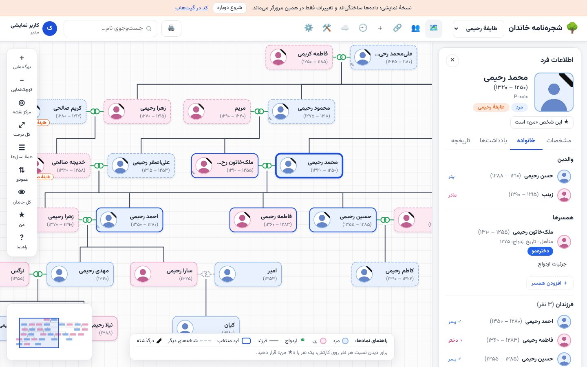
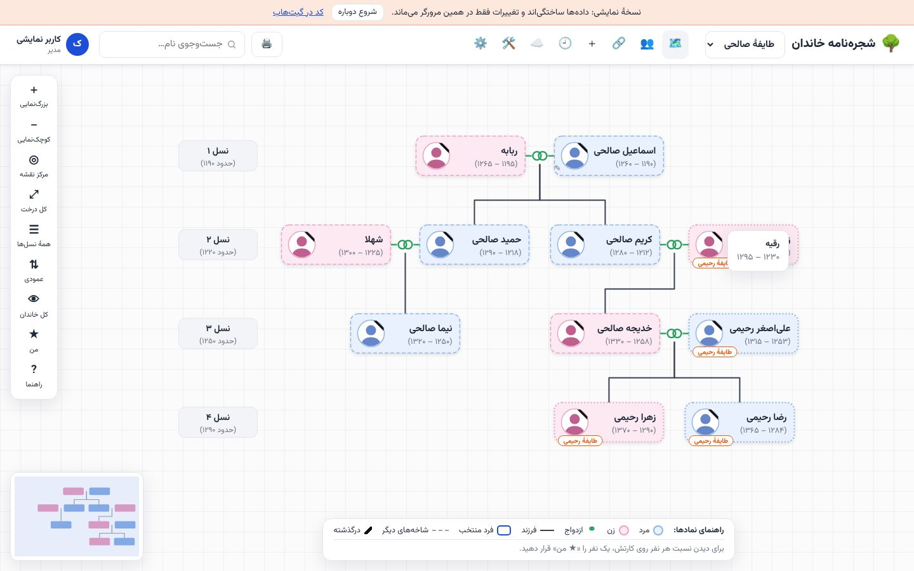

<div dir="rtl">

# 🌳 شجره‌نامه خاندان

شجره‌نامه‌ساز فارسی و رایگان که روی **Cloudflare Workers** اجرا می‌شود؛ برای ثبت چند خاندان و طایفه که با ازدواج‌ها به هم گره خورده‌اند، با همهٔ نسبت‌های فارسی، دسترسی جدا برای هر عضو خانواده، حالت آفلاین و چاپ چندصفحه‌ای.

### [🔍 دموی زنده را ببینید](https://familytree-demo.m-cyber-warrior.workers.dev)

بدون ثبت‌نام، با چهار طایفهٔ ساختگی در شش نسل. هر تغییری بدهید فقط در مرورگر خودتان می‌ماند.





## ✨ امکانات

### درخت و نمایش
- هر نسل در یک ردیف، زن و شوهر کنار هم با حلقهٔ ازدواج، و خطوط فرزندان؛ با بزرگ‌نمایی، جابه‌جایی، لمس دوانگشتی و نقشهٔ کوچک.
- با انتخاب هر شخص، او و همسر و فرزندانش به مرکز صفحه می‌آیند. حالت «خانوادهٔ نزدیک» فقط بستگان نزدیک را نشان می‌دهد.
- نمایش فقط نسل‌های «از … تا …».
- چیدمان عمودی، یا افقی (فرزندان زیر هم) برای خانواده‌های پرجمعیت.
- واکنش‌گرا در موبایل و دسکتاپ، با حالت تاریک.

### نسبت‌های فارسی
- یک نفر را «★ من» کنید تا روی کارت هر کس نسبتش نوشته شود: پدر، عروس، داماد، عمو، دایی، پسرعمو، دخترخاله، برادرزاده، پدرزن، مادرشوهر، باجناق، جاری، زن‌عمو، نامادری… و نسبت‌های ترکیبی مثل «پسرعموی پدر».
- ازدواج فامیلی خودکار شناخته می‌شود و اگر کسی از چند راه نسبت داشته باشد (مثلاً همسر و دخترعمو)، همه نشان داده می‌شوند.
- ابزار «خویشاوندی با فرد دیگر» نسبت هر دو نفر را پیدا می‌کند و مسیرش را روی درخت نشان می‌دهد.

### چند خاندان و طایفه
- هر طایفه درخت جداگانهٔ خودش را دارد. عروس و داماد می‌توانند در طایفهٔ خانوادهٔ خودشان ثبت شوند و در درخت طایفهٔ همسرشان «مهمان» دیده شوند.
- جابه‌جا کردن هر شخص (همراه با نیاکان یا نوادگانش) به طایفهٔ دیگر.

### دسترسی و حریم خصوصی
- **نخستین کسی که وارد شود، مدیر می‌شود.** نیازی به راه‌اندازی اولیه نیست.
- مدیر برای هر کاربر تعیین می‌کند: کدام طایفه، کل طایفه یا کدام شاخه و زیرشاخه، دیدن یا افزودن و ویرایش یا حذف، و تا کدام نسل.
- دسترسی‌ها در **گروه‌های دسترسی** دسته‌بندی می‌شوند (مثلاً «ویرایشگران طایفهٔ صالحی»).
- همه‌چیز روی سرور کنترل می‌شود. اطلاعاتی که کسی اجازهٔ دیدنش را ندارد اصلاً به گوشی یا مرورگرش نمی‌رسد.

### آفلاین و همگام‌سازی
- نصب‌شدنی مثل یک اپ (PWA). بدون اینترنت هم شجره‌نامه دیده و ویرایش می‌شود.
- با وصل شدن دوباره، تغییرات خودکار به سرور فرستاده می‌شوند. اگر کس دیگری همان فیلد را عوض کرده باشد، پنجرهٔ تعارض باز می‌شود تا انتخاب کنید کدام بماند.
- ذخیرهٔ تغییرات آفلاین در فایل و بارگذاری بعدی آن روی سرور اصلی.

### تاریخچه
- هر تغییر با نام کاربر و زمان ثبت می‌شود و هر شخص را می‌شود به نسخه‌های قبلی‌اش برگرداند.
- مدیر می‌بیند هر شخص را چه کسی اضافه کرده و آخرین بار چه کسی تغییرش داده است، و افراد حذف‌شده را بازیابی می‌کند.

### چاپ و PDF
- چاپ از نسل دلخواه تا نسل دلخواه، روی A4 یا A3.
- تقسیم خودکار به چند صفحه طوری که هر شاخه و زیرشاخه در یک صفحه بیاید و نوشته‌ها ریز نشوند، یا تعیین تعداد صفحه.
- یادداشت‌ها کنار نام هر شخص، یا به‌صورت فهرست در گوشهٔ هر صفحه.

### دیگر امکانات
- نام هر شخص با نام پدرانش در فهرست‌ها («علی رحیمی فرزند حسن فرزند محمد») تا هم‌نام‌ها قاطی نشوند.
- یادداشت برای هر شخص، که با نگه داشتن موس روی کارت هم دیده می‌شود.
- پشتیبان‌گیری و بازیابی کامل به‌صورت فایل JSON.

## 🚀 راه‌اندازی برای خانوادهٔ خودتان

به یک حساب رایگان [Cloudflare](https://dash.cloudflare.com/sign-up) و **Node.js نسخهٔ ۲۲ یا بالاتر** نیاز دارید. اگر نسخهٔ Node شما قدیمی است، با [nvm](https://github.com/nvm-sh/nvm) نصبش کنید: `nvm install 22`.

```bash
git clone https://github.com/Aryalleh/Familytree.git
cd Familytree
npm install
npx wrangler login                     # ورود به حساب Cloudflare
npx wrangler d1 create familytree      # database_id چاپ‌شده را در wrangler.toml بگذارید
npm run deploy                         # ساخت جدول‌ها و انتشار
```

آدرسی که چاپ می‌شود را باز کنید و حساب خودتان را بسازید؛ شما مدیر می‌شوید. برای به‌روزرسانی‌های بعدی کافی است `git pull` و دوباره `npm run deploy` را اجرا کنید.

### اجرای محلی

```bash
npm run db:migrate:local
npm run dev            # http://localhost:8787
npm run dev:demo       # دموی بدون دیتابیس روی http://localhost:8788
npm test               # تست‌ها
npm run typecheck
```

### انتشار دمو

```bash
npm run deploy:demo    # فقط فایل‌های ثابت با نام familytree-demo؛ به نسخهٔ اصلی و دیتابیس آن دست نمی‌زند
```

</div>

## English

A Persian (RTL) family-tree app for several intermarried clans, running on **Cloudflare Workers + D1** with no build step and no UI framework. **[Live demo](https://familytree-demo.m-cyber-warrior.workers.dev)** (runs entirely in your browser with sample data).

Features: generational tree layout with couples and pan/zoom; a Persian kinship engine (blood, in-law and step relations, cousin marriages, multiple relations at once); separate trees per clan with spouses from other clans shown as guests; per-user grants and access groups (clan / branch / level / generation limit) enforced server-side; installable offline PWA with automatic sync and three-way merge with a conflict dialog; per-record version history with restore; multi-page print that keeps each branch on one page.

Setup: Node.js 22+, then `npm install`, `npx wrangler login`, `npx wrangler d1 create familytree` (put the id in `wrangler.toml`), and `npm run deploy`. The first account created becomes the admin.

### Project layout

| Path | What |
| --- | --- |
| `src/index.ts` | Worker: JSON API (auth, users, access, clans, people, marriages, history, import/export) |
| `src/auth.ts` | PBKDF2 password hashing, session cookies (stored as SHA-256 hashes in D1) |
| `src/versions.ts` | Versions, change history and three-way merge |
| `migrations/` | D1 schema |
| `public/js/kinship.js` | Persian kinship engine |
| `public/js/generations.js` | Generations, clans, branches and permissions (shared by the Worker and the browser) |
| `public/js/tree.js` | Layout (dagre over couple blocks) and SVG rendering, pan/zoom, minimap |
| `public/js/print.js` | Print planning: generation range, branch-per-page pagination, note list |
| `public/js/offline.js` | Offline snapshot, queue of offline edits, replay with versions |
| `public/js/demo.js` | In-browser stand-in for the API, used only by the demo build (`scripts/build-demo.js`, `wrangler.demo.toml`, `demo/data.json`) |
| `public/sw.js` | Service worker that keeps the app available offline |
| `public/js/app.js` | UI |
| `public/vendor/dagre.esm.js` | Vendored [dagre](https://github.com/dagrejs/dagre) (`npm run vendor` refreshes it) |

### Security notes

- Passwords: PBKDF2-SHA256, 100k iterations, random salt.
- Sessions: random 256-bit token in an `HttpOnly; SameSite=Lax; Secure` cookie. Only its hash is stored.
- API mutations need `Content-Type: application/json`, which blocks cross-site form CSRF.
- Every route except status/setup/login/register needs a login, and every response is filtered by the user's grants.
